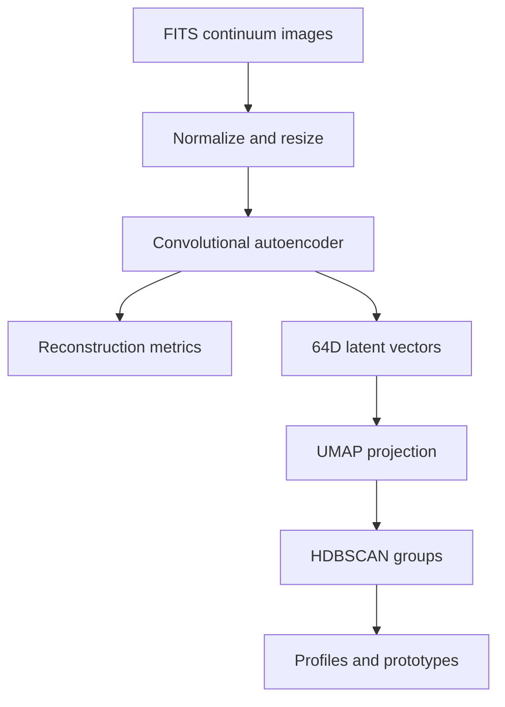

# Protoplanetary disk morphology exploration
### FITS images → autoencoder embeddings → exploratory clusters

This repository explores disk-image morphology with a convolutional autoencoder, UMAP and HDBSCAN. It includes work prepared for the **EXXA GSoC 2026 test tasks**, a synthetic FITS generator and notebook/script workflows. That context does not imply GSoC selection, affiliation or a published scientific result.

**Python · PyTorch · Astropy · UMAP · HDBSCAN · Matplotlib · MLflow**

[Read the notebook](notebooks/colab_EXXA2.ipynb) · [Training code](training/train_autoencoder.py) · [Main pipeline](EXXA_GSoC2026_Pipeline.py)

**Status:** exploratory/local research prototype. No hosted demo or independently reproduced performance claim is provided.

## What it does

- Reads continuum layer 0 from FITS cubes and normalizes/resizes images to 256 × 256.
- Trains an encoder/decoder with a **64-dimensional latent space** and MSE plus an MS-SSIM structural term.
- Extracts embeddings, projects them with UMAP and groups them with HDBSCAN.
- Produces reconstruction, cluster/prototype and radial-profile plots for inspection.
- Generates synthetic disk images to smoke-test the workflow when real task data is unavailable.



**Example, not an observed discovery:** a generated ring/gap image can be reconstructed and placed near visually similar synthetic images. Cluster separation alone does not establish planet count or a physical mechanism.

## Local setup

Python **3.12** is a reasonable starting point for this dependency set; a clean full install and training run were not reproduced in this refresh. Use a fresh environment:

```bash
git clone https://github.com/krishmannadal/UNSUPERVISED_ASTRONOMY.git
cd UNSUPERVISED_ASTRONOMY
python -m venv .venv
source .venv/bin/activate
# Windows PowerShell: .\.venv\Scripts\Activate.ps1
```

`requirements.txt` is a broad Windows environment export and includes `pywin32==311`, which cannot install on Linux/macOS. To preserve its other pins while excluding that platform-only entry:

```bash
python -c "from pathlib import Path; p=Path('requirements.txt'); Path('requirements-portable.txt').write_text('\n'.join(x for x in p.read_text().splitlines() if not x.lower().startswith('pywin32=='))+'\n')"
python -m pip install -r requirements-portable.txt
```

On Windows the original requirements file may be used. These are documented setup paths, not a guarantee that every recorded pin resolves on every platform. No environment variables or remote API keys are read by the core pipeline; MLflow uses local defaults unless configured separately.

## Data and execution

Place task FITS data in `data/continuum_data_subset/`, or generate test inputs:

```bash
python generate_dummy_data.py
```

The default generator creates **30 synthetic examples**, not the 100 formerly stated. It can overwrite same-named `disk_*.fits` files; use a separate test-data copy when working with real data. Synthetic examples are software fixtures, not ALMA observations.

```bash
python -m training.train_autoencoder
python EXXA_GSoC2026_Pipeline.py
```

The trainer is configured for 50 epochs and saves `models/autoencoder_final.pth`. A checkpoint with that name is tracked, but its training provenance and measured performance were not independently established in this audit. The main script opens plots and writes files under `outputs/`, including reconstruction comparisons, UMAP clusters and radial profiles. The notebook is available directly in GitHub; no placeholder Colab link is advertised.

## Evaluation boundaries and known issues

- The former 0.92 silhouette / 0.49 MS-SSIM / 0.012 MSE figures lack a linked run artifact in this checkout and are omitted as verified results.
- Training/validation subsets share an augmentation-enabled dataset; validation therefore also receives random augmentation. The split is not explicitly seeded in the trainer.
- The pipeline continues with random weights if the checkpoint is missing or incompatible. Check its console output before interpreting plots.
- Some MS-SSIM errors are caught and replaced with zero or omitted. A completed run is not proof that the structural metric was valid.
- UMAP geometry and synthetic generation choices can drive clustering. Morphological groups are not independently validated physical classes.

Next: create an explicit seeded train/validation split with deterministic validation transforms; fail clearly on invalid checkpoints/metrics; preserve dataset/checkpoint hashes and run outputs; evaluate on held-out real data with justified scientific labels.

## Credits and licensing

Repository history records work by Krishmannadal. The EXXA task context is described in [the proposal](EXXA_GSoC_2026_Proposal.md); it is a proposal, not proof of program participation. External data retains its source terms. No repository-level license file is present, and none is added here.
